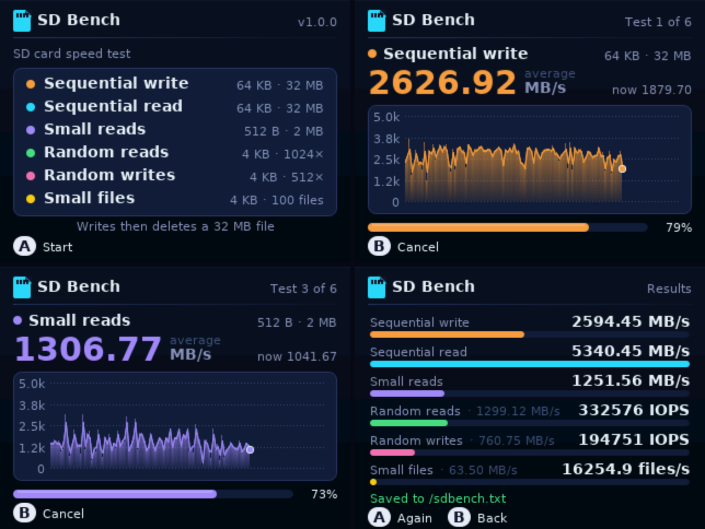

# SD Bench — SD card speed test for Game & Watch Retro-Go SD



A homebrew for the Nintendo Game & Watch (Zelda or Mario) with the
[Retro-Go SD](https://github.com/sylverb/game-and-watch-retro-go-sd)
firmware that measures how fast the SD card reads and writes, with a live
chart of the speed during each test and a results screen. It uses the
firmware's own file functions, the same ones games and emulators use, so the
numbers are what a game really gets.

## Installation

Requires Retro-Go SD **v2.0.0-rc1 or later** (firmware ABI v2).

1. Download `SDBench-vX.Y.Z.zip` from the
   [releases](https://github.com/landsat77/sdbench-gnw/releases) (or build it).
2. Copy `homebrews/SDBench.bin` to the `/homebrews/` folder of the SD card.
3. Start **SD Bench** from the **Homebrew** tab and press **A**.

The card needs 33 MB of free space. See [INSTALL.md](INSTALL.md) (English
and French).

## The tests

| # | Test | What it shows |
|---|---|---|
| 1 | Sequential write, 64 KB blocks, 32 MB | Writing big files (closing the file is counted: that is when the last data reach the card) |
| 2 | Sequential read, 64 KB blocks, 32 MB | Loading big files, packs, ROMs |
| 3 | Sequential read, 512 byte blocks, 2 MB | The cost of many small reads |
| 4 | Random reads, 4 KB, 1024 reads | IOPS and latency: a game fetching data here and there |
| 5 | Random writes, 4 KB, 512 writes | IOPS of small writes (saves) |
| 6 | Small files: create, write 4 KB, close, x100 | Creating files (saves, screenshots) |

- The 32 MB test file is far bigger than any RAM cache: reads come from the
  card.
- Timing uses the CPU's cycle counter (microseconds); drawing the screen is
  not counted.
- **B** cancels at any time. The test files (`/sdbench.tmp`,
  `/sdbench_files/`) are always deleted at the end.
- The results are appended to **`/sdbench.txt`** on the card, with the date,
  to compare cards. Its format (the numbers here are only an example):

```
SD Bench v1.0.0 - 2026-10-25 16:21
  Sequential write 64 KB           x.xx MB/s
  Sequential read 64 KB            x.xx MB/s
  Sequential read 512 B            x.xx MB/s
  Random read 4 KB                  xxx IOPS    x.xx MB/s    x.xx ms
  Random write 4 KB                 xxx IOPS    x.xx MB/s    x.xx ms
  Small files (create+4 KB)        xx.x files/s  x.xx MB/s
```

Controls: **A** start / start again, **B** cancel / back, **PAUSE/SET**
Retro-Go menu (on the home and results screens). The texts follow the
firmware's language (English or French).

## Building

```
make            # → SDBench.bin
make host       # PC version (SDL2): ./SDBench_host, files in ./host_sd
make docker     # same as make, inside the Retro-Go SD builder image
```

Needs `arm-none-eabi-gcc` (hard-float, v10+ with newlib), GNU Make, Python 3
with Pillow. On Ubuntu:
`sudo apt install gcc-arm-none-eabi libnewlib-arm-none-eabi libsdl2-dev python3-pil`.

The PC version runs headless for checks:
`SDL_VIDEODRIVER=dummy SDB_AUTOSTART=1 SDB_SHOTS=dir ./SDBench_host`
(runs the tests once, saves the screens as PPM in `dir`, quits; `GW_LANG=fr`
for French).

Releases: a release made on github.com (tag `vX.Y.Z`, with its section in
`CHANGELOG.md`) makes the CI build and attach `SDBench-vX.Y.Z.zip`.

## Layout

| Path | What |
|---|---|
| `src/main.c` | The tests, the screens, the results file |
| `src/gfx.c`, `src/gfx.h` | Drawing: gradients, rounded rectangles, anti-aliased lines and text |
| `src/font_data.h` | DejaVu Sans glyphs, 4-bit anti-aliased (made by `tools/make_font.py`) |
| `src/assets/cover.png` | Launcher cover (made by `scripts/make_cover_art.py`) |
| `host/` | PC build (SDL2) from the template |
| `sdk/` | Retro-Go SD core / homebrew SDK (from retro-go-sd-templates) |

## Licences

MIT (`LICENSE`), like the retro-go-sd-templates SDK it is built on. The
DejaVu fonts: Bitstream Vera licence (free to embed).
